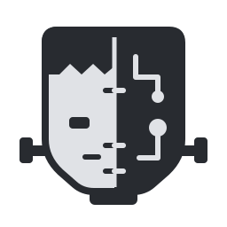

<p align="center">
  <picture>
    <source media="(prefers-color-scheme: dark)" srcset="assets/brand/logo-dark.svg">
    
  </picture>
</p>

# GuestWeave

**GuestWeave is the guest intervention runtime powering [Firmenstein](https://github.com/Firmenstein/Firmenstein).**

It is a Rust framework for running Linux usermode programs with controlled changes
to guest functions, callsites and file-like resources. GuestWeave uses LibAFL-QEMU
as its execution backend and exposes a public intervention API that can also be
used by standalone Rust applications.

[API](docs/api.md) · [Build guide](docs/build.md) · [Support and limits](docs/support.md)

## What it provides

- **Function and callsite hooks:** inspect arguments, read and write guest memory,
  control returns, or invoke guest code through `native_call`.
- **Pseudo-files:** implement caller-defined resources with explicit ownership,
  descriptor duplication, open-file state and supported syscall error semantics.
- **Process and exec handoff:** restore supported pseudo-file state across managed
  exec transitions, including byte-preserving guest arguments and environment.
- **Execution evidence:** collect raw traces, loaded-image identities and address
  mappings so an application can explain what actually ran.
- **Rust and plugin entry points:** link interventions directly or load compatible
  ABI-v4 shared objects through the supplied harnesses. Rebuild older plugins
  before loading them into an ABI 4 runtime.
- **Pinned builds:** prepare a complete offline source delivery with maintained
  native dependencies, vendored Cargo crates and an optional exported builder.

## Its role in Firmenstein

Firmenstein analyzes firmware, plans and generates interventions, supervises
execution, and evaluates application scenarios. GuestWeave supplies the guest
execution and intervention layer underneath those activities.

GuestWeave accepts behavior and bindings chosen by its caller. It does not decide
which firmware behavior to emulate or whether an application scenario succeeded.
The framework source and independent examples build without Firmenstein Core.
See [Core integration](docs/integration.md) for the interface boundary.

## Supported configuration

The runtime requires **Linux/glibc** and Rust **1.98.0**. Choose exactly one guest
architecture for each build:

| Cargo feature | Guest ABI |
| --- | --- |
| `x86_64` | x86-64 Linux, little endian |
| `arm` | ARM32 A32 EABI, little endian |
| `mips` | MIPS o32, little endian |
| `mipsbe` | MIPS o32, big endian |

The current real-guest contract matrix is validated on a Linux ARM64 Docker host.
Other host configurations need their own validation. This release is a path-based
library; it is not published to crates.io. Existing `fmst-iib-*` crate names and
`fmst-harness-*` executables remain part of the compatibility interface.

## Get started

Python 3.9+, Git and Rust 1.98.0 are needed. Run these commands in a new workspace:

```sh
git clone https://github.com/Firmenstein/GuestWeave.git
cd GuestWeave
python3 tools/prepare_dependencies.py
cargo test --locked -p fmst-iib-api --features mock
cargo run --locked --example pseudo_file --features mock
```

The preparation script creates the pinned `../lib/LibAFL` checkout. Its patch is
already committed; do not apply it again. An existing checkout is verified and
never reset. Cargo requires this directory even for API-only workspace resolution.
The commands above exercise the API without running QEMU.

For a complete real-guest example, build the Linux builder and prepare a delivery:

```sh
docker build -t guestweave/builder:rust1.98-bookworm docker/builder
python3 tools/offline.py prepare \
  --output "$PWD/dist/offline" \
  --builder-image guestweave/builder:rust1.98-bookworm \
  --export-builder
python3 tools/offline.py run \
  --delivery "$PWD/dist/offline" \
  --output "$PWD/tmp/native-call-x86" \
  --arch x86_64 --suite native-call
```

Preparation downloads pinned inputs. Each `run` verifies them, disables networking
and builds in a new native Docker volume with an empty Cargo home and target.
Output directories must be new. See the [build guide](docs/build.md) for other
architectures, direct Linux builds and transfer to an offline machine.

## Embed it in Rust

Add a path dependency with one runtime feature:

```toml
[dependencies]
guestweave = { path = "../GuestWeave", features = ["x86_64"] }
```

A minimal worker can run a guest and collect a trace:

```rust,no_run
use guestweave::{run, RunConfig};

fn main() -> Result<(), Box<dyn std::error::Error>> {
    let mut config = RunConfig::new("/path/to/guest", "/path/to/rootfs");
    config.trace_output = Some("/path/to/evidence/trace.json".into());
    run(config)?;
    Ok(())
}
```

Set `config.intervention = Intervention::Static(&MANIFEST)` to link behavior and
bindings directly. The [embedded example](examples/embedded/README.md) contains a
complete manifest, callsite hook, pseudo-file and managed exec example. The
[native-call example](examples/native_call_contract/README.md) exercises guest
function calls across all four supported architectures. Intervention authors can
also use the checkout's [public authoring skill](skills/intervention-engineering/SKILL.md).

## Runtime boundaries

Run once in a dedicated worker process, on its main thread before starting other
threads. QEMU may exit or replace that worker directly; callers own timeout,
cancellation and cleanup. A rootfs is a loader prefix, not a sandbox.

Exec is disabled unless a launcher is configured. Managed exec reconstructs
registered behavior and supported state snapshots; it does not preserve arbitrary
Rust heap/global state or promise shared mutable state between concurrent forked
processes. Hook binding uses loaded-image basenames and offsets with ambiguity
checks. Thumb, general dynamic-loader behavior and arbitrary firmware semantics
are outside the current validated scope. See [API contracts](docs/api.md),
[ABI reference](docs/abi.md) and [support limits](docs/support.md).

## Maintained dependencies and licenses

GuestWeave uses matched snapshots from [Firmenstein/LibAFL](https://github.com/Firmenstein/LibAFL),
[Firmenstein/qemu-libafl-bridge](https://github.com/Firmenstein/qemu-libafl-bridge)
and [Firmenstein/libvharness](https://github.com/Firmenstein/libvharness).
Exact source commits and patch hashes live in [`dependencies/`](dependencies/).
The LibAFL byte-argument extension is integrated; the QEMU bridge and libvharness
start from the validated upstream implementations.

GuestWeave's own source is licensed under [Apache-2.0](LICENSE).
Dependencies retain their own licenses, including QEMU's GPL and file-specific
notices. See [third-party provenance](THIRD_PARTY.md). The framework's license
does not replace the licenses of a combined runtime or redistributed dependency.
